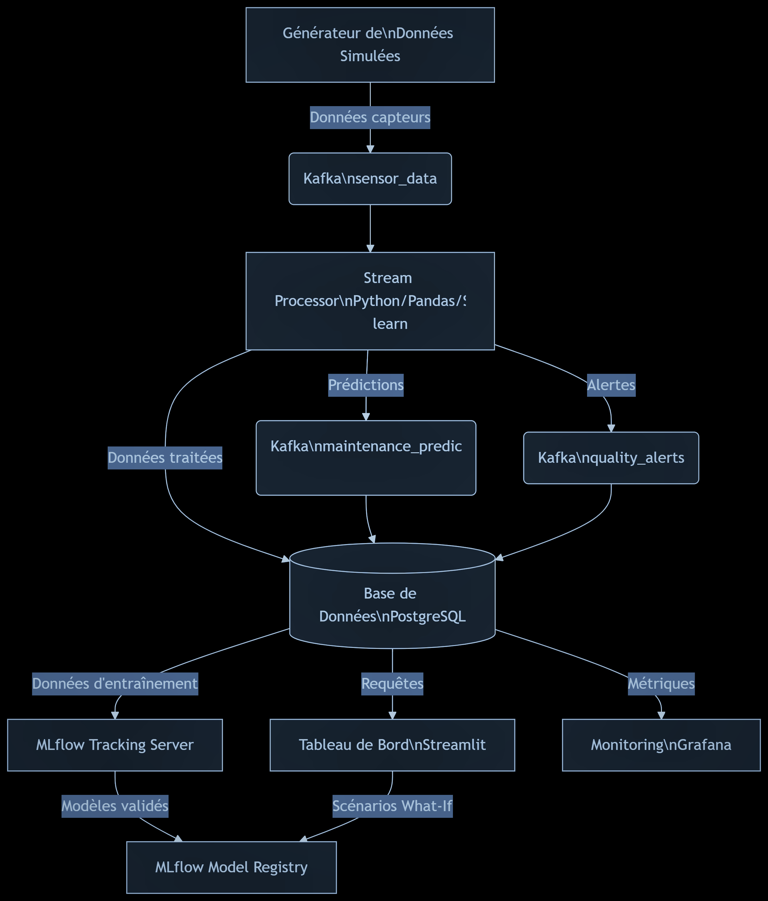
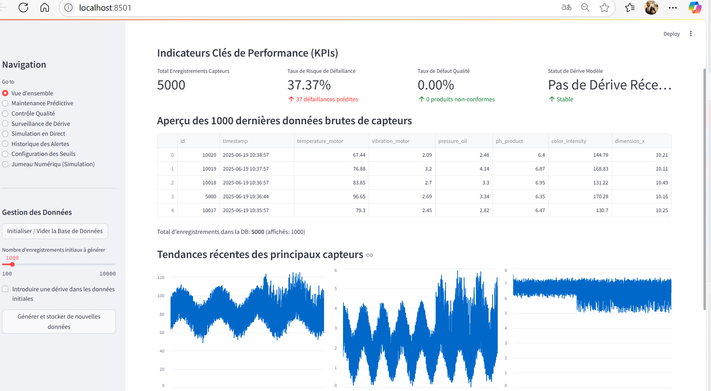
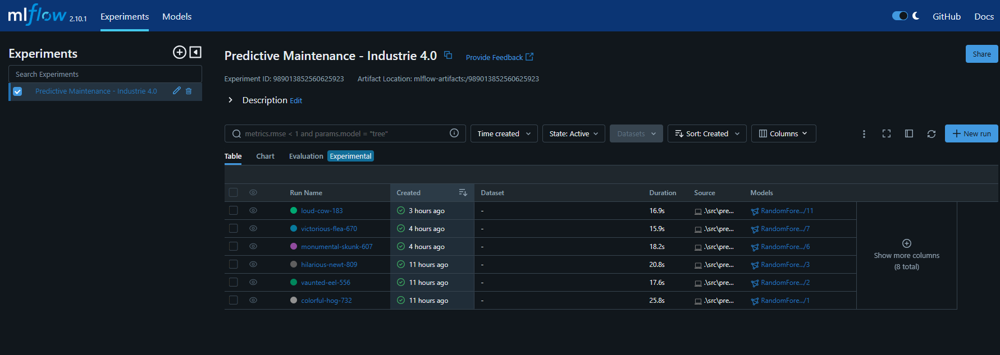
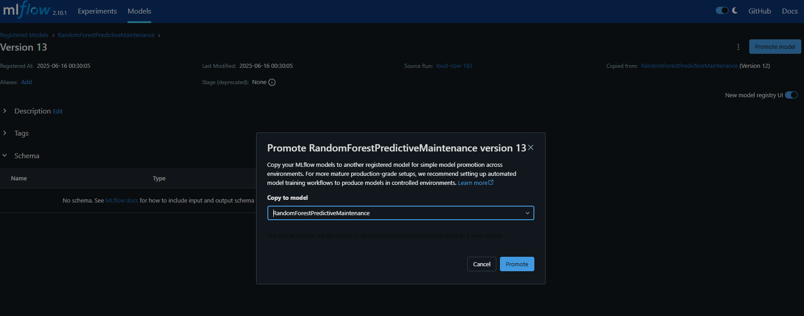
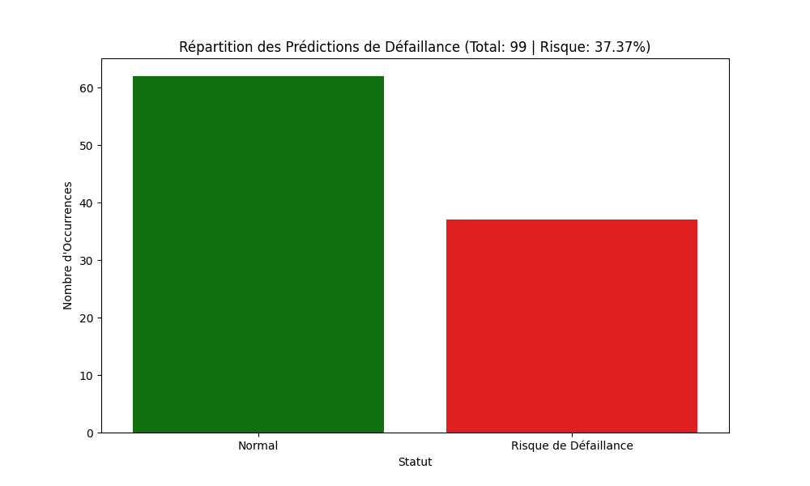
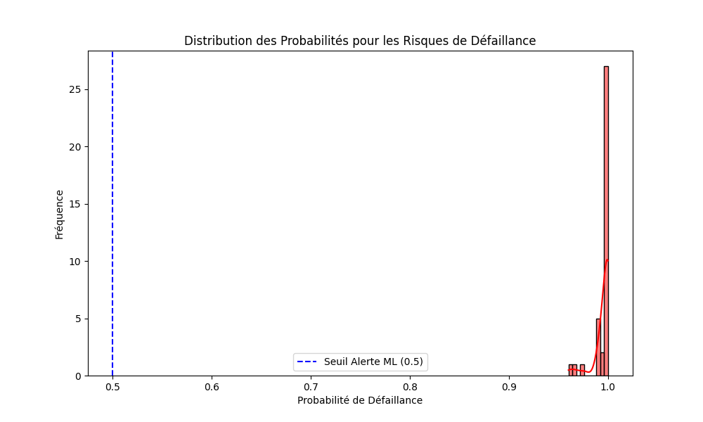
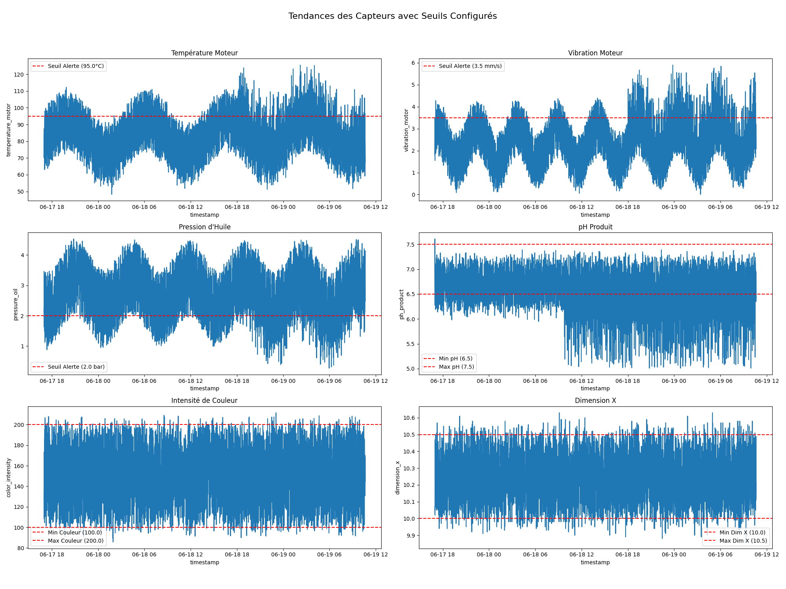
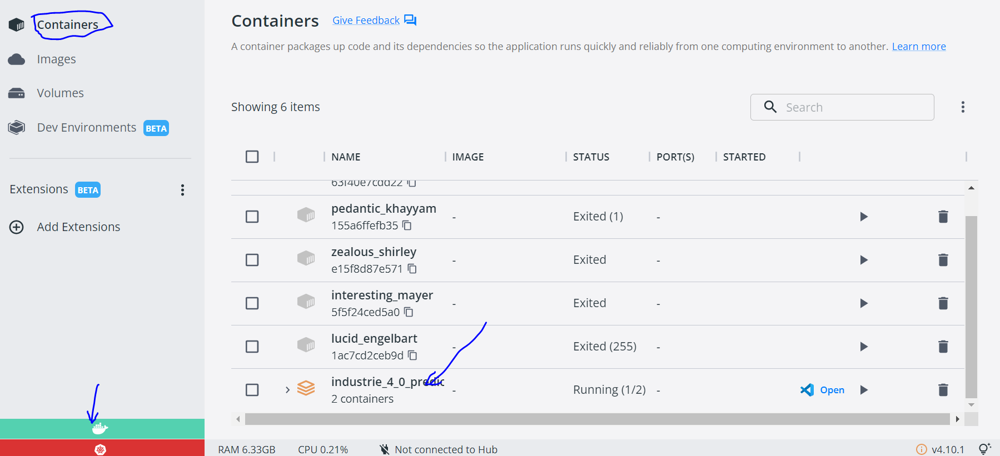

# Optimisation Prédictive de la Production en Industrie 4.0

Ce projet démontre l'application de l'Intelligence Artificielle (IA), du Machine Learning (ML) et de l'analyse de données pour l'optimisation des processus de production dans un contexte d'Industrie 4.0, avec une architecture conteneurisée prête pour le déploiement.

## Table des matières

1.  [Introduction](#1-introduction)
2.  [Objectifs du Projet](#2-objectifs-du-projet)
3.  [Architecture du Projet](#3-architecture-du-projet-vision-globale)
4.  [Composants Techniques](#4-composants-techniques-et-implémentation)
    * [Gestion des Données (Base de Données SQLite)](#41-gestion-des-données-base-de-données-sqlite)
    * [Simulateur de Données](#42-simulateur-de-données)
    * [Module de Maintenance Prédictive](#43-module-de-maintenance-prédictive-machine-learning)
    * [Module de Contrôle Qualité](#44-module-de-contrôle-qualité-analyse-de-données-et-règles)
    * [Processeur de Flux (Streaming Simulation)](#45-processeur-de-flux-streaming-simulation)
    * [Visualisation des Résultats Statiques](#46-visualisation-des-résultats-statiques)
    * [MLflow Integration (Suivi des Expérimentations & Déploiement)](#47-mlflow-integration-suivi-des-expérimentations--déploiement)
    * [Application de Visualisation Interactive (Streamlit)](#48-application-de-visualisation-interactive-streamlit)
    * [Orchestration avec Docker Compose](#49-orchestration-avec-docker-compose)
5.  [Préparation de l'Environnement](#5-préparation-de-lenvironnement)
6.  [Démonstration du Savoir-Faire](#6-démonstration-du-savoir-faire)
7.  [Tests en Laboratoire](#7-tests-en-laboratoire)
8.  [Déploiement CI/CD sur GKE](#8-déploiement-cicd-sur-gke)
9.  [Améliorations Futures](#9-améliorations-futures)

## 1. Introduction

Ce projet synthétique explore comment les technologies de l'Industrie 4.0, notamment l'IA et l'analyse de données, peuvent être utilisées pour améliorer l'efficacité opérationnelle et la qualité des produits. Nous nous concentrons sur deux cas d'usage clés : la maintenance prédictive des équipements et le contrôle qualité en temps quasi réel, en intégrant des pratiques MLOps avec MLflow, une gestion de données persistante, et une interface utilisateur interactive avec Streamlit, le tout orchestré par Docker Compose.

## 2. Objectifs du Projet

* Réduire les temps d'arrêt imprévus des machines.
* Améliorer la qualité des produits en identifiant rapidement les anomalies.
* Démontrer un pipeline de données de bout en bout, de la génération à l'analyse et au stockage.
* Présenter des exemples concrets d'application du Machine Learning et de l'analyse de données.
* Simuler l'intégration continue de données et la visualisation des résultats clés.
* Introduire le concept de **gestion du cycle de vie du Machine Learning (MLOps)** avec MLflow pour le suivi des expérimentations et le déploiement des modèles.
* Fournir une **interface utilisateur interactive** pour visualiser les résultats et interagir avec le système.
* **Orchestrer l'ensemble des services** (Streamlit, MLflow, base de données) pour une configuration et un déploiement facilités en environnement de laboratoire ou de production.

## 3. Architecture du Projet

Le projet suit une architecture modulaire et conteneurisée :



L'ensemble de ces composants sera orchestré par **Docker Compose** pour une mise en place rapide.

* **Gestion des Données :** Une base de données SQLite persistante (`data/industry_data.db`) stocke les données brutes des capteurs, les prédictions de maintenance et les alertes qualité.
* **Génération de Données :** Un script Python simule des données de capteurs et les insère dans la base de données.
* **Traitement et Analyse :** Des modules Python dédiés effectuent la maintenance prédictive (ML) et l'analyse de contrôle qualité (règles). Un processeur de flux simule l'ingestion continue.
* **MLflow :** Le suivi des expérimentations et le registre des modèles sont gérés par un serveur MLflow, permettant un suivi et un déploiement facilités.
* **Visualisation Statique :** Un script Python génère des rapports visuels statiques à partir des données de la DB.
* **Application Interactive :** Une application Streamlit fournit une interface conviviale pour la démonstration, lisant et écrivant dans la DB.
* **Orchestration :** Docker Compose gère le cycle de vie des conteneurs pour Streamlit et MLflow.

## 4. Composants Techniques

### 4.1. Gestion des Données (Base de Données SQLite) (`src/database_manager.py`)

Ce module fournit des fonctions pour :
* Établir une connexion à une base de données SQLite (`data/industry_data.db`).
* Créer les tables nécessaires pour stocker les **lectures brutes des capteurs**, les **prédictions de maintenance** et les **alertes qualité**.
* Insérer et récupérer les données depuis ces tables.

### 4.2. Simulateur de Données (`src/data_simulator.py`)

Génère des données de capteurs (température, vibration, pression d'huile pour les machines ; pH, intensité de couleur, dimensions pour les produits) avec des anomalies simulées. Les données générées sont directement **insérées dans la base de données** via le `database_manager`.

### 4.3. Module de Maintenance Prédictive (`src/predictive_maintenance.py`)

* **Technique :** Machine Learning (RandomForestClassifier).
* **Objectif :** Prédire la probabilité de défaillance d'une machine basée sur les données de ses capteurs.
* **Processus :**
    * **Chargement des données depuis la DB.**
    * Prétraitement des données, incluant la création d'une étiquette `failure` simulée et l'ajout de `lag features`.
    * Entraînement et évaluation d'un modèle de classification.
    * **Intégration MLflow :** Chaque entraînement est loggué avec ses paramètres, métriques et le modèle lui-même dans MLflow Tracking. Le modèle est également enregistré dans le MLflow Model Registry.
    * Les prédictions générées après entraînement sont **stockées dans la base de données**.

### 4.4. Module de Contrôle Qualité (`src/quality_control.py`)

* **Technique :** Analyse de données basée sur des règles métier.
* **Objectif :** Identifier les produits hors spécifications basées sur des seuils de qualité.
* **Processus :**
    * **Chargement des données de capteurs liées à la qualité depuis la DB.**
    * Application de règles pour déterminer si un paramètre (pH, couleur, dimension) est hors tolérance.
    * **Stockage des alertes qualité dans la base de données.**
    * Génération d'un rapport synthétique des problèmes de qualité.

### 4.5. Processeur de Flux (Streaming Simulation) (`src/stream_processor.py`)

Ce script simule un flux continu de données de capteurs. Pour chaque nouvelle lecture :
* Il l'insère dans la table `sensor_readings` de la DB.
* Il **charge le modèle de maintenance prédictive directement depuis le MLflow Model Registry** (étape "Production").
* Il effectue une prédiction de maintenance et une analyse de contrôle qualité.
* Il **stocke les prédictions de maintenance et les alertes qualité dans leurs tables respectives** de la DB.
* Il affiche les alertes en temps quasi réel en console.

### 4.6. Visualisation des Résultats Statiques (`src/visualizer.py`)

Génère des graphiques statiques (fichiers `.png` dans le dossier `reports/`) en **récupérant toutes les données et les prédictions/alertes depuis la base de données**. Ces graphiques visualisent les tendances des capteurs, les défaillances prédites, les distributions des paramètres qualité et un résumé des alertes qualité.

### 4.7. MLflow Integration (Suivi des Expérimentations & Déploiement)

MLflow est utilisé pour :
* **MLflow Tracking :** Enregistrer les paramètres, métriques et artefacts (modèles) de chaque exécution d'entraînement dans `predictive_maintenance.py`. Cela permet de comparer et d'auditer les différentes versions de modèles.
* **MLflow Model Registry :** Centraliser la gestion des modèles entraînés. Les modèles sont versionnés et peuvent être promus à différentes étapes (Staging, Production), ce qui facilite le déploiement et la gestion du cycle de vie. Le `stream_processor.py` charge le modèle directement depuis ce registre.
Le serveur MLflow sera exécuté dans un conteneur Docker.

### 4.8. Application de Visualisation Interactive (Streamlit) (`app.py`)

Une application web construite avec Streamlit, offrant une interface utilisateur interactive pour :
* **Récupérer et visualiser un aperçu des données brutes des capteurs depuis la DB.**
* **Afficher les résultats de la maintenance prédictive** (prédictions et historiques) avec des graphiques des tendances des capteurs et des alertes.
* **Examiner les résultats du contrôle qualité**, y compris les distributions des paramètres et un résumé des alertes, le tout **récupéré de la DB**.
* **Simuler un flux de données en direct** directement depuis l'interface. Cette simulation génère des données, effectue des prédictions/analyses, et les **insère en temps réel dans la base de données**.
* Offre des options pour **initialiser la base de données** ou **générer des données initiales**.

### 4.9. Orchestration avec Docker Compose (`Dockerfile`, `Dockerfile_mlflow`, `docker-compose.yml`)

* **`Dockerfile` (pour Streamlit) :** Définit l'environnement et les dépendances nécessaires pour l'application Streamlit.
* **`Dockerfile_mlflow` (pour MLflow Server) :** Définit l'environnement pour le serveur MLflow Tracking.
* **`docker-compose.yml` :** Orchestre le démarrage de deux services conteneurisés :
    * `mlflow_server` : Le serveur MLflow, persistant ses données de tracking et ses modèles.
    * `streamlit_app` : L'application Streamlit, ayant accès aux données (DB) et aux modèles, et dépendant du serveur MLflow.
Grafana : Outil de visualisation et de surveillance open-source, parfait pour des tableaux de bord dynamiques en temps réel et des alertes sophistiquées.
Jumeau Numérique (Digital Twin - simplifiée) : Une représentation fonctionnelle de la machine permettant de simuler des scénarios "what-if" basés sur les modèles ML déployés.

## 5. Préparation de l'Environnement

1.  **Cloner le dépôt :**
    ```bash
    git clone [https://github.com/john-desing/industrie_4_0_predictive_optimization.git](https://github.com/john-desing/industrie_4_0_predictive_optimization.git)
    cd industrie_4_0_predictive_optimization
    ```
2.  **Prérequis Docker :** Assurez-vous que [Docker Desktop](https://www.docker.com/products/docker-desktop/) est installé et en cours d'exécution sur votre système.

## 6. Démonstration du Savoir-Faire

Pour exécuter l'ensemble du projet et observer la démonstration :

1.  **Préparer les dossiers nécessaires (s'ils n'existent pas) :**
    ```bash
    mkdir -p data models mlruns reports
    ```

2.  **Démarrer l'ensemble de l'écosystème avec Docker Compose :**
    ```bash
    docker-compose up --build -d
    ```
    * `--build` force la reconstruction des images Docker.
    * `-d` exécute les conteneurs en arrière-plan.

3.  **Accéder aux services :**
    * **Application Streamlit :** Ouvrez votre navigateur à l'adresse `http://localhost:8501`.
    
    * **Interface utilisateur MLflow :** Ouvrez votre navigateur à l'adresse `http://localhost:5000`.
    

4.  **Initialiser les données et entraîner le modèle :**
    * Dans l'application **Streamlit** (http://localhost:8501) :
        * Dans la **barre latérale**, cliquez sur "Initialiser / Vider la Base de Données".
        * Cliquez ensuite sur "Générer et stocker de nouvelles données" pour remplir la base de données initiale.
    * **Exécuter l'entraînement du modèle ML (nécessaire une seule fois) :**
        Dans votre terminal local (hors Docker), assurez-vous d'être dans l'environnement virtuel et exécutez :
        ```bash
        python src/predictive_maintenance.py
        ```
        * Ceci entraînera le modèle et le loguera dans MLflow.
        * Allez dans l'interface MLflow (http://localhost:5000), naviguez vers le modèle `RandomForestPredictiveMaintenance` dans le **Model Registry**.
        * Cliquez sur la dernière version de votre modèle et changez son stage en **"Production"**. C'est crucial pour que les simulateurs de flux puissent le charger.

5.  **Observer la simulation et les résultats :**
    * Dans l'application **Streamlit** (http://localhost:8501) :
        * Allez dans la section **"Vue d'ensemble"** pour voir les données brutes.
        * Allez dans **"Maintenance Prédictive"** et **"Contrôle Qualité"** pour voir les analyses statiques basées sur les données initiales de la DB.
        * Allez dans **"Simulation en Direct"** et cliquez sur "Démarrer la simulation de flux". Observez les alertes en temps réel qui sont également persistées dans la base de données.
    * Dans l'interface **MLflow** (http://localhost:5000) :
        * Explorez les "Experiments" pour voir les détails de vos entraînements de modèles.
        * Dans le "Models" Registry, observez votre modèle `RandomForestPredictiveMaintenance` et ses versions.
        

6.  **Générer des rapports statiques (optionnel) :**
    Dans votre terminal local (hors Docker) :
    ```bash
    python src/visualizer.py
    ```
    Cela générera les images de rapport dans le dossier `reports/`.
      

7.  **Arrêter les services Docker :**
    ```bash
    docker-compose down
    ```

## 7. Tests en Laboratoire

Le projet est désormais entièrement **conteneurisé et persistant**, ce qui facilite grandement les tests en laboratoire :


* **Reproducibilité :** L'utilisation de Docker garantit que l'environnement d'exécution est identique, indépendamment de la machine hôte.
* **Tests de Charge :** Modifiez les paramètres de `num_records` dans le simulateur ou la fréquence de `time.sleep()` dans la simulation en direct pour tester la performance du système avec un volume de données plus élevé.
* **Tests de Dérive de Modèle :** Simulez une "dérive de concept" en modifiant les règles de génération d'anomalies dans `data_simulator.py` (par exemple, des seuils différents pour les pannes) et observez comment le modèle entraîné réagit. Cela pourrait justifier un réentraînement (que vous loggerez dans MLflow).
* **Tests de Persistance :** Arrêtez et redémarrez les conteneurs (`docker-compose down` puis `docker-compose up`). Vérifiez que toutes les données (lectures, prédictions, alertes, logs MLflow) sont bien persistées grâce aux volumes Docker.
* **Tests d'Évolutivité :** Bien que non implémenté ici, l'architecture par microservices prépare le terrain pour une évolutivité future (ex: faire tourner le processeur de flux sur un autre service, ajouter plus de Workers si le traitement était intensif).
* **Tests de Robustesse :** Introduisez des données manquantes ou des formats incorrects (en modifiant le simulateur) pour voir comment le pipeline de prétraitement et les modèles réagissent.

## 8. Déploiement CI/CD sur GKE

Le dépôt comprend une CI GitHub Actions, des manifestes Kubernetes et une configuration Terraform pour Google Kubernetes Engine (GKE Autopilot) et Artifact Registry.

### Préparation Google Cloud et GitHub

1. Créez un bucket Cloud Storage privé pour l'état Terraform, activez le versionnement et conservez le nom du bucket.
2. Configurez Workload Identity Federation pour GitHub Actions, restreinte au dépôt `john-desing/industrie_4_0_predictive_optimization_01`. Associez le fournisseur à un compte de service Google Cloud.
3. Accordez à ce compte les rôles nécessaires à la création du cluster et du registre (`roles/container.admin`, `roles/artifactregistry.admin`, `roles/serviceusage.serviceUsageAdmin`, `roles/compute.networkAdmin` et `roles/iam.serviceAccountUser`). Pour le déploiement, il doit aussi pouvoir administrer les ressources du cluster.
4. Dans les paramètres GitHub du dépôt, définissez les variables `GCP_PROJECT_ID`, `GCP_REGION` (par défaut `europe-west1`), `GKE_CLUSTER_NAME` (par défaut `industrie-4-0`), `GCP_ARTIFACT_REGISTRY_REPOSITORY` (par défaut `industrie-4-0`) et `TF_STATE_BUCKET`.
5. Définissez les secrets `GCP_WORKLOAD_IDENTITY_PROVIDER` (nom de ressource complet du fournisseur WIF) et `GCP_SERVICE_ACCOUNT` (adresse e-mail du compte de service).

### Provisionner et déployer

1. Dans **Actions → Terraform GKE → Run workflow**, lancez le workflow sans cocher `apply` pour examiner le plan. Relancez-le en cochant `apply` pour créer le registre et le cluster.
2. Les pull requests vers `master` valident la syntaxe Python et construisent les deux images sans les publier.
3. Chaque push sur `master` publie les images horodatées par SHA dans Artifact Registry, applique les manifestes de `k8s/` et attend le déploiement sur GKE.
4. Récupérez l'adresse IP publique de l'application avec `kubectl get service streamlit-app -n industrie-4-0`. MLflow reste accessible uniquement à l'intérieur du cluster.

Les fichiers SQLite de l'application et les données MLflow utilisent des volumes persistants GKE. Les modèles entraînés ne sont pas versionnés : l'image crée un modèle de démonstration reproductible uniquement lorsqu'aucun modèle entraîné n'est présent dans le contexte de construction. Pour la production, protégez le service public par une authentification et remplacez les données de démonstration par des artefacts de modèle gérés.

## 9. Améliorations Futures
